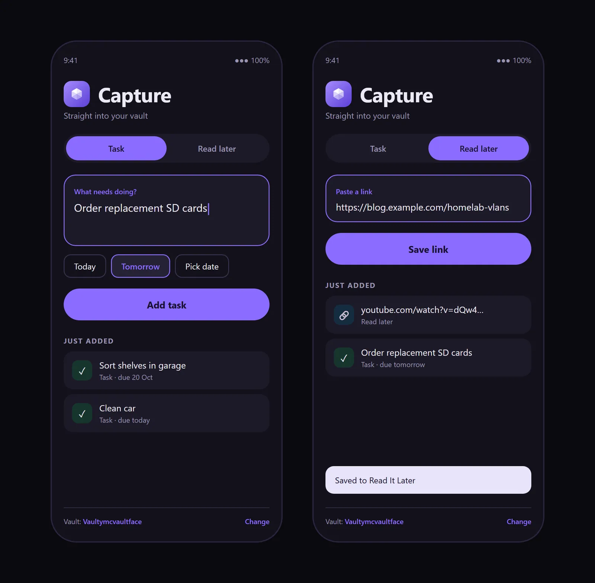
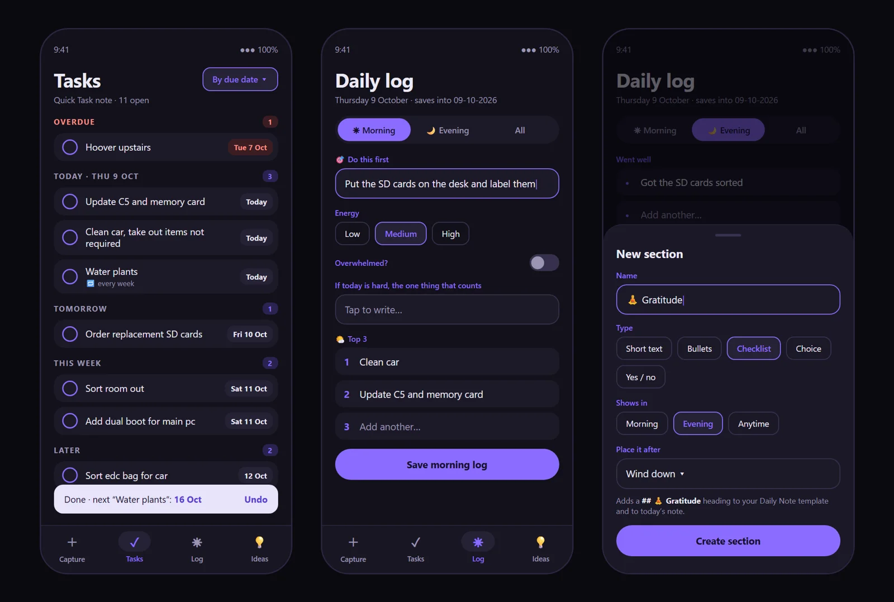
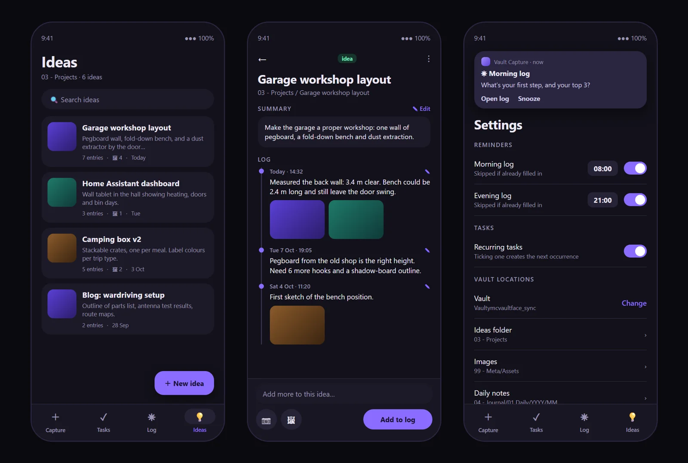
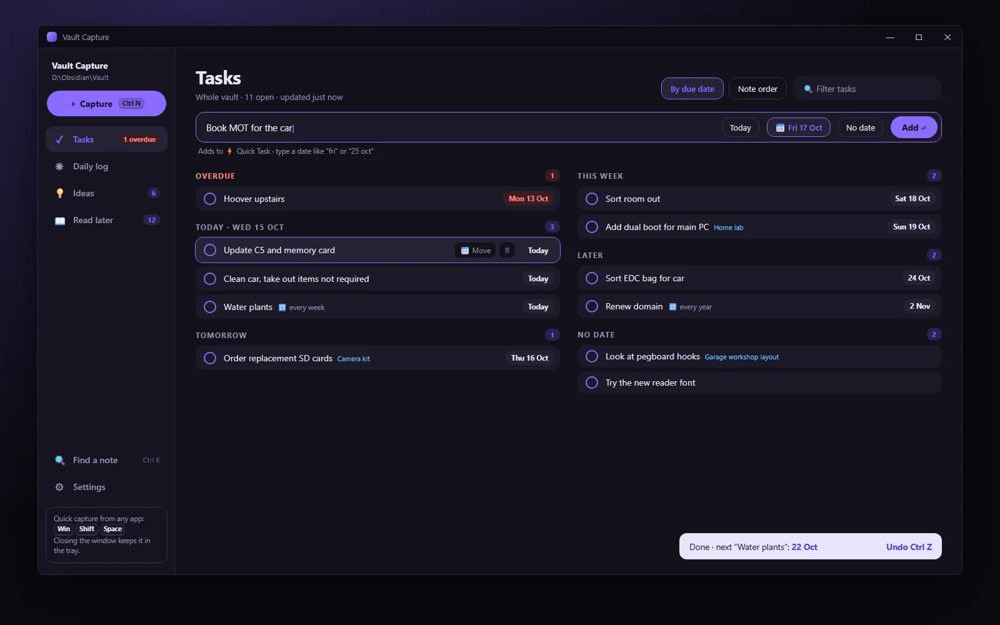

**The outcome:** a two-button capture tool became my daily home screen in three and a half weeks. Version 1.1 to 1.7, 25 merged pull requests, an Android app and a Windows app, all writing plain Markdown into one Obsidian vault.

## Version 1: a thought has about five seconds to live

You think of something. Open the notes app, find the right note, scroll to the right heading, type it in. By the time you've done all that, you've forgotten what you came for. Most of my good ideas have died somewhere between "I should write that down" and the third screen of Obsidian.

Vault Capture is a small Android app I built to fix that. A task or a link goes from my phone into my Obsidian vault in a couple of taps, without opening Obsidian at all.

### Two jobs, and nothing else

- **Task:** adds a line to the `## Active` list in my Quick Task note, with a due date: Today, Tomorrow or a picked date.
- **Read later:** saves a link into my Read It Later inbox in the vault.

The best trick is the Share sheet. See something worth keeping in Chrome, YouTube or Reddit, hit Share, tap Vault Capture, and it's saved with no screen at all.

### No lock-in, no cleverness

It writes plain Markdown straight into the synced vault. No server, no account, nothing to break. If I stop using the app tomorrow, every note it ever made is still just a file in my vault.

## How it grew

Every version came from using the last one daily and noticing what got in the way.

| When | What changed, and why |
|---|---|
| 7 Oct | **Vault Capture 1.1.** Task and Read later, plus the Share sheet. One dark screen, built for one hand. |
| 9 Oct | **Four tabs.** Tasks sorted by due date with recurring tasks, a Daily log, and Ideas with photo logs. Capture alone wasn't enough; I needed to see and finish what I'd saved. |
| 12 Oct | **A proper reader and widgets (1.4).** Read later became a reader with highlights, text size and a remembered place. Home screen widgets and quick search cut the steps to almost nothing. Writes made safe alongside Obsidian Sync. |
| 14–15 Oct | **Version 1.5 and a Windows app.** The vault logic moved into a shared core, so the desktop app reads and writes exactly the same files. |
| 22 Oct | **Took the Daily log out (1.6).** I'd stopped filling it in. Reminders moved into Tasks. Removing a feature was the right design call. |
| 25–26 Oct | **Flight Deck 1.7.** A navy theme, five tabs and a Deck home screen that shapes the day around energy. |
| 28–31 Oct | Windows app brought up to match, and habits you can add, reorder and pause. |

## Flight Deck: designed around energy, not lists

The big shift in 1.7 was from "a place to put things" to "what should I do next". The Deck screen answers that first.

- **Energy chip.** Low, Med or High. A low day moves "Stuck? Pick one." to the top and prefers tasks of 15 minutes or less. A high day shows three top tasks instead of two.
- **Next step.** One task, with Start (opens a focus timer) or Later (hides it until tomorrow).
- **Cards you arrange.** Weather and travel time (only when an event needs it), today's calendar, bills due, habits and water, read-later count and job applications. Each card can be reordered or hidden.
- **Brain dump.** Type or dictate a messy thought, and **Sort it** uses Claude to split it into tasks, ideas and a note. Nothing is saved until you check it.

## How I built it with AI

I'm a designer, not an Android developer, so I built this with Claude Code. I worked as the art director: I set the brief, designed the screens and the logo, and decided how each part should behave. Claude Code wrote the Kotlin to match.

That meant I spent my time on the design calls: what goes on screen, what gets cut, and how a tap should feel. It took me from a mockup to a working app on my phone much faster than learning Android development from scratch, and made it cheap to try an idea, live with it for a day and change it. AI is also part of the product itself, in the Brain dump's Sort it.

I wrote about the same way of working in [Rebuilding My Portfolio With Claude Code](/blog/14-portfolio-rebuild-with-claude-code/).

**Design:** the interface, the faceted gem identity, and the Flight Deck theme and layout.

**Built with:** Claude Code, Kotlin and Jetpack Compose on Android, and a Windows desktop app sharing the same core.

I wrote more about how the first version and my [Auto Folder Creator](/projects/auto-folder-creator/) came together in [Tiny Tools, Less Friction](/blog/11-tiny-tools-less-friction/).
