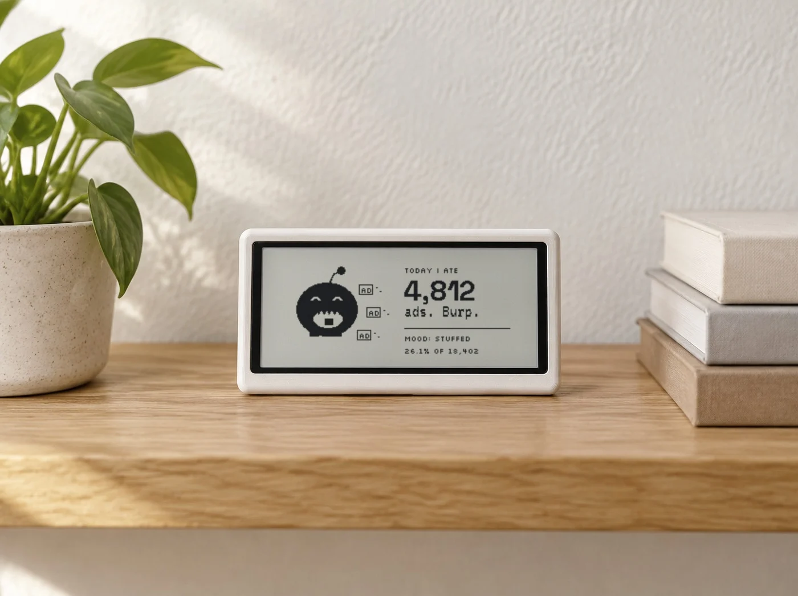
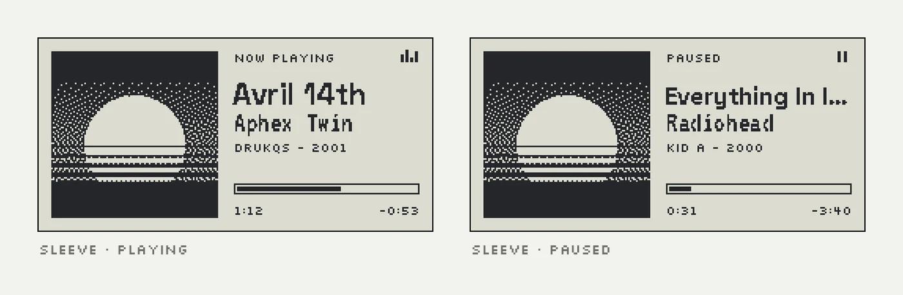
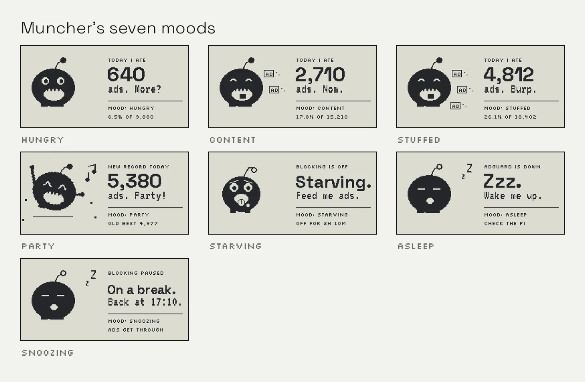
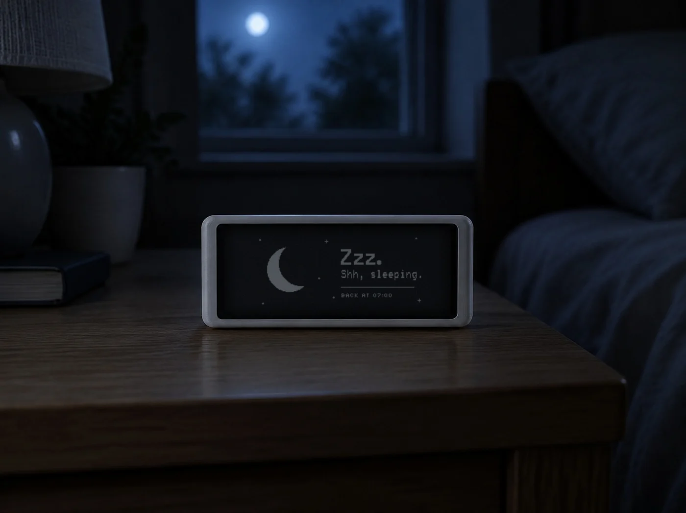
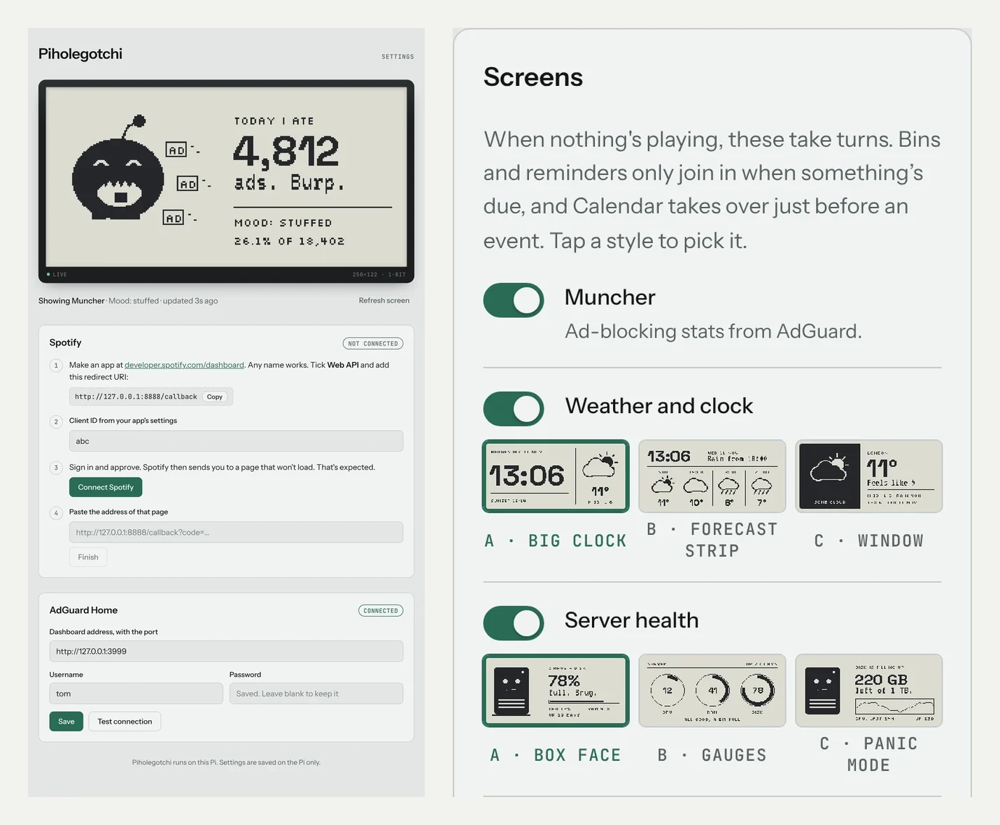
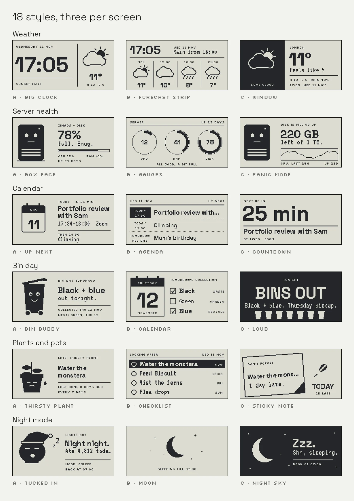

**The outcome:** in one day, a Pwnagotchi from a drawer became a calm screen for the house. It runs 8 screens with 18 styles, boots from an SD card that GitHub builds itself, and is set up and updated from a phone, with no terminal.

*Mock-up: the real screen on a generated shelf.*

## Snapshot

- **Role:** Solo. I designed every screen and made the product decisions. Claude wrote the code, the SD card build and the setup guide from my direction.
- **Tools:** Claude, Raspberry Pi Zero W, Waveshare 2.13" e-ink, AdGuard Home, Spotify, GitHub Actions
- **Timeframe:** One day, from first mock-up to a working device
- **Platform:** A 250×122 black and white e-ink screen, plus a settings page for your phone

## The problem

I had a Pwnagotchi sitting in a drawer: a lovely little e-ink gadget built for something I don't need. I wanted it to show useful things at a glance: what's playing, how many ads my home network is blocking, when the bins go out. It also had to be set up from a phone, with no terminal.

E-ink is a tough brief. You get two colours and 250×122 pixels, and every full redraw makes the panel flash.

## Design at the real size

I drew every mock-up at 250×122 in pure black and white, in the fonts the device actually uses, so nothing surprised me later.

For music I picked **Sleeve**: dithered album art beside the track.

For ad blocking, the **Muncher**: a little creature whose mood follows how much it's eating. A character makes people smile. A chart doesn't.

## Work with the flash, not against it

Sleeve stays put while music plays, and reminders cut in only briefly. The progress bar uses the panel's quick refresh, which doesn't flash. Overnight, the screen draws once and switches off.

*Mock-up: the real Night sky screen in a generated bedroom.*

## Put the settings on a phone

A web page at piholegotchi.local shows a live view of the screen, a switch for each screen and an Update button.

When I couldn't choose between three styles, I built all three. Each one shows as a thumbnail drawn from my real data, and I pick from there.

## What didn't work

The first SD card image looked dead. The screen driver failed on boot and took the settings page down with it, so nothing showed on the screen or on the network. We changed the start-up order so the settings page comes up first, stays up when the screen fails, and says what went wrong.

Halfway through, I also realised I run AdGuard Home on my server, not Pi-hole. Switching made the Pi a display only, and setup got shorter as a result. The name stuck.

## The result

- An SD card image that GitHub builds by itself. Raspberry Pi Imager adds your Wi-Fi, and the Pi boots to a "Set me up" screen.
- 8 screens: Sleeve, Muncher (7 moods), weather and clock, server health, calendar, bin day, plant and pet reminders, and night mode. 18 styles to swap from the settings page.
- Updates come from the settings page, with no re-flashing.

**What I learnt:** tight limits made decisions quick. The AI did the heavy engineering. My job was editing: choosing, cutting, and noticing when something felt wrong.

## What I'd do next

Watch someone else set it up from a blank card, then design a proper stand for it.
